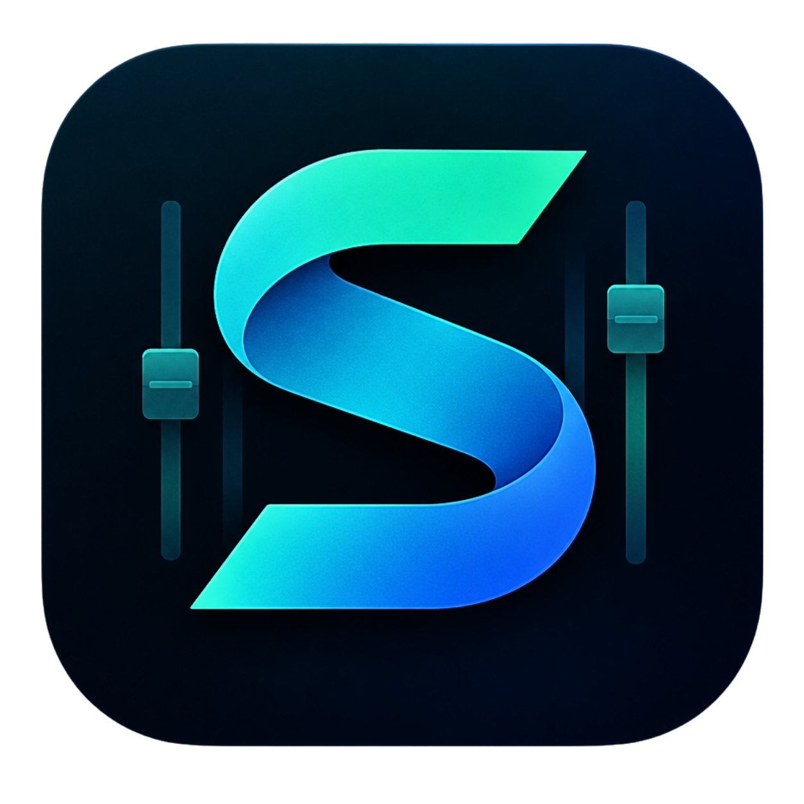

# StageTracks

  

**StageTracks es una aplicación para preparar y reproducir secuencias musicales en vivo desde Windows.** El proyecto busca que músicos y equipos de escenario puedan organizar sus canciones y controlar su reproducción con una herramienta pensada para el trabajo en directo.

## ¿Para qué sirve?

StageTracks ayuda a preparar una presentación antes de salir al escenario y a manejarla durante el concierto. Permite organizar canciones en secuencias, trabajar con sus pistas de audio y controlar la reproducción desde una interfaz diseñada para usarse mientras se toca.

El proyecto también integra herramientas para quienes trabajan con **REAPER**, incluido Reaper Control Studio, y una comunidad para encontrar y compartir secuencias compatibles.

## ¿A quién está dirigido?

- Músicos y bandas que usan pistas de acompañamiento en sus presentaciones.
- Equipos de alabanza y ministerios musicales que preparan repertorios para servicios y eventos.
- Técnicos y operadores que necesitan controlar secuencias durante un evento en vivo.
- Usuarios de Windows que trabajan con REAPER y buscan controlar su sesión desde una interfaz práctica.
- Creadores que quieren compartir sus secuencias con otros músicos.

StageTracks es especialmente útil para quienes necesitan una alternativa en Windows para preparar y ejecutar secuencias en vivo, sin depender de que todo el equipo use macOS o iOS.

## Ecosistema

- **StageTracks para Windows:** prepara y reproduce secuencias para presentaciones en vivo.
- **Reaper Control Studio:** controla funciones de REAPER desde su aplicación de escritorio o desde la interfaz web configurada en REAPER.
- **Comunidad StageTracks:** permite buscar y compartir secuencias; requiere conexión al servicio de comunidad.
- **Sitio oficial:** [stagetrack-project.vercel.app](https://stagetrack-project.vercel.app/)

## El proyecto

StageTracks nace de una necesidad concreta: contar en Windows con una herramienta de secuencias en vivo accesible y enfocada en músicos. Es un proyecto independiente que busca crecer junto a su comunidad y facilitar los preparativos y la ejecución de música en directo.

Este repositorio contiene el código fuente y los recursos para desarrollar el ecosistema StageTracks. Para instrucciones de compilación, publicación de la web y configuración de los servicios, consulta [DEPLOYMENT.md](DEPLOYMENT.md).
